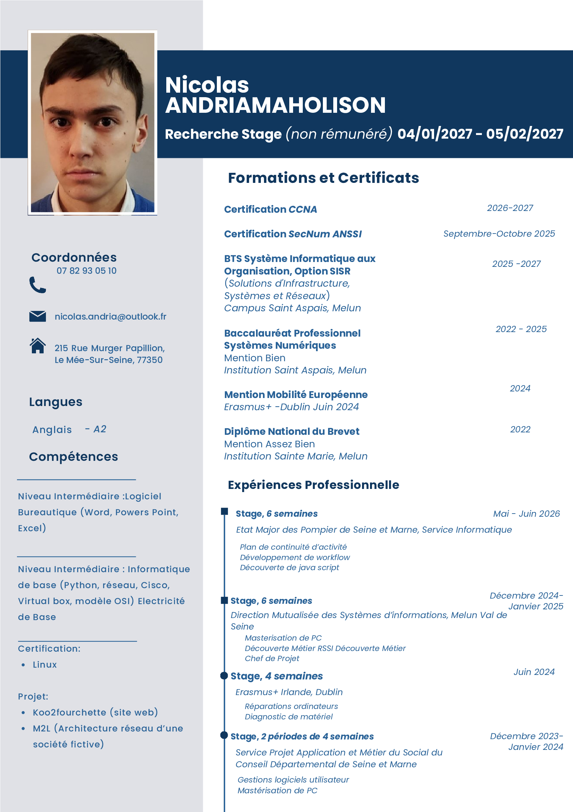

<!DOCTYPE html>
<html lang="fr">
<head>
  <meta charset="UTF-8">
  <meta name="viewport" content="width=device-width, initial-scale=1.0">
  <title>Nicolas ANDRIAMAHOLISON — Portfolio BTS SIO</title>
  <meta name="description" content="Portfolio étudiant BTS SIO — Nicolas ANDRIAMAHOLISON, spécialité SISR.">

  <!-- Polices Google Fonts : Space Grotesk (titres), Inter (texte courant), JetBrains Mono (données techniques) -->
  <link rel="preconnect" href="https://fonts.googleapis.com">
  <link rel="preconnect" href="https://fonts.gstatic.com" crossorigin>
  <link href="https://fonts.googleapis.com/css2?family=Space+Grotesk:wght@500;600;700&family=Inter:wght@400;500;600&family=JetBrains+Mono:wght@400;500&display=swap" rel="stylesheet">

  <link rel="stylesheet" href="style.css">
</head>
<body>

  <!-- ==================== NAVIGATION ==================== -->
  <header class="site-header">
    <nav class="navbar" aria-label="Navigation principale">
      <a href="#accueil" class="navbar__brand">
        <!-- A MODIFIER : vos initiales ou un petit logo -->
        NA
        Nicolas ANDRIAMAHOLISON
      </a>

      <button class="navbar__toggle" id="navToggle" aria-expanded="false" aria-controls="navMenu" aria-label="Ouvrir le menu">
        
      </button>

      <ul class="navbar__menu" id="navMenu">
        <li><a href="#accueil">Qui suis-je</a></li>
        <li><a href="#formations">Formations</a></li>
        <li><a href="#competences">Compétences</a></li>
        <li><a href="#experiences">Expériences</a></li>
        <li><a href="#projets">Projets</a></li>
        <li><a href="#cv">CV &amp; LM</a></li>
        <li><a href="#contact" class="navbar__cta">Contact</a></li>
      </ul>
    </nav>
  </header>

  <main>

    <!-- ==================== 1. QUI SUIS-JE ==================== -->
    <section id="accueil" class="section hero">
      

        
Étudiant BTS SIO — option SISR

        <h1 class="hero__title">
          <!-- A MODIFIER : votre nom complet -->
          Nicolas ANDRIAMAHOLISON
        </h1>
        
        

          <!-- A MODIFIER : présentation personnelle en 3-4 phrases -->
          Actuellement en 2ᵉ année de BTS Services Informatiques aux Organisations
          (option SISR) au Campus Saint Aspais, Melun.
          Fort d'un socle technique combinant développement, réseaux et cybersécurité, 
          j'ai validé mes acquis via des certifications reconnues (Cisco, ANSSI). 
          Curieux et rigoureux, je nourris également mon profil par la lecture et la musique. 
          
        

        

          <a href="#contact" class="btn btn--primary">Me contacter</a>
          <a href="#cv" class="btn btn--ghost">Voir mon CV</a>
        

      

      <aside class="hero__panel" aria-label="Fiche d'identité rapide">
        

          
          
          
          Le BTS SIO
        

        <dl class="panel__list">
          

            Le BTS SIO (Services informatiques aux organisations) 
            forme des professionnels capables de mettre en place et de gérer des services informatiques au sein des entreprises, 
            administrations ou sociétés de services informatiques.
           
        </dl>
        <!-- A MODIFIER : remplacez src par le chemin vers votre photo -->
        <a class="hero__photo" href="BTS_ServicesInformatiquesOrganisations .pdf" target="_blank">Référentie Officiel</a>
         
        <a class="hero__photo" href="https://institutionsaintaspais.fr/campus/" target="_blank">Campus Saint Aspais</a>
      </aside>
    </section>

    <!-- ==================== 2. FORMATIONS & CERTIFICATIONS ==================== -->
    <section id="formations" class="section">
      

        <h2>Formations &amp; certifications</h2>
        
Mon parcours scolaire et les certifications obtenues en complément.

      

      

        <!-- A MODIFIER : dupliquez / ajustez chaque carte selon votre parcours -->
        <article class="card">
          
2025 — 2027

          <h3 class="card__title">BTS Services Informatiques aux Organisations</h3>
          
Option SISR — Solutions d'Infrastructure, Systèmes et Réseaux. 
          <!-- A MODIFIER --> Campus Saint Aspais, Melun

        </article>

        <article class="card">
          
2025

          <h3 class="card__title">ANSSI — SecNumacadémie</h3>
          
Formation en ligne gratuite sur les fondamentaux de la cybersécurité. 
          <!-- A MODIFIER --> Parcours complété à 100%

        </article>

         <article class="card">
          
2024 — 2025

          <h3 class="card__title">Baccalauréat professionnels</h3>
          
 SN (Système Numérique) 
          <!-- A MODIFIER --> Mention Bien — Lycée Saint Aspais

        </article>

        <article class="card">
          
2025 - 2027

          <h3 class="card__title">Cisco CCNA — Introduction to Networks</h3>
          
 
          <!-- A MODIFIER --> Cisco Networking Academy

        </article>

        <article class="card">
          
2024

          <h3 class="card__title">Cisco</h3>
          
Linux 
          <!-- A MODIFIER --> Netacade

        </article>
      

    </section>

    <!-- ==================== 3. COMPÉTENCES ==================== -->
    <section id="competences" class="section section--alt">
      

        <h2>Compétences</h2>
        
Compétences techniques et humaines développées durant ma formation.

      

      

        

          <h3 class="skills__title">Hard skills</h3>

          

            
Systèmes &amp; réseaux

            <ul class="tag-list">
              <!-- A MODIFIER : ajustez selon votre niveau -->
              <li class="tag">Windows</li>
              <li class="tag">Linux (Debian/Ubuntu)</li>
              <li class="tag">Réseau de base (DHCP, DNS ...) </li>
              <li class="tag">VLAN &amp; routage</li>
              <li class="tag">Proxmox</li>
              <li class="tag">Cybersécurité</li>
              
            </ul>
          

          

            
Développement

            <ul class="tag-list">
              <li class="tag">HTML / CSS</li>
              <li class="tag">Git / GitHub</li>
            </ul>
          

          

            
Bases de données

            <ul class="tag-list">
              <li class="tag">MySQL</li>
              <li class="tag">Maria DB</li>
            </ul>
          

            

            
Badges

            <ul class="tag-list">
              <li class="tag">  </li>
            
            </ul>
          

        

        

          <h3 class="skills__title">Soft skills</h3>
          <ul class="soft-list">
            <!-- A MODIFIER : gardez 4 à 6 qualités maximum -->
            <li>
              Rigueur
              Documentation systématique des procédures et interventions techniques.
            </li>
            <li>
              Travail d'équipe
              Habitué au travail en mode projet lors des ateliers de professionnalisation.
            </li>
            <li>
              Pédagogie
              Capable de vulgariser un problème technique pour un public non-initié.
            </li>
            <li>
              Curiosité
              Veille technologique régulière sur les sujets réseau et sécurité.
            </li>
            <li>
              Gestion du temps
              Organisation autonome des missions en environnement multi-projets.
            </li>
          </ul>
        

      

    </section>

    <!-- ==================== 4. EXPÉRIENCES PROFESSIONNELLES ==================== -->
    <section id="experiences" class="section">
      

        <h2>Expériences professionnelles</h2>
        
Stages et missions réalisés durant ma formation.

      

      

        <!-- A MODIFIER : dupliquez ce bloc pour chaque expérience -->
        <article class="timeline__item">
          

          

            

              <h3 class="card__title"><!-- A MODIFIER -->Stage informatique</h3>
              
<!-- A MODIFIER -->SDIS 77 · Mai — Juin 2026 · 6 semaines

            

            <ul class="card__list">
              <!-- A MODIFIER : missions réalisées -->
              <li>Mise en place PCA (Plan de Continuité d'activité) </li>
              <li>Découverte développmement de workflow N8N</li>
             
            </ul>
          

        </article>

          <article class="timeline__item">
          

          

            

              <h3 class="card__title"><!-- A MODIFIER -->Stage informatique</h3>
              
<!-- A MODIFIER -->SDIS 77 · Mai — Juin 2026 · 6 semaines

            

            <ul class="card__list">
              <!-- A MODIFIER : missions réalisées -->
              <li>Mise en place PCA (Plan de Continuité d'activité) </li>
              <li>Découverte développmement de workflow N8N</li>
             
            </ul>
          

        </article>

          <article class="timeline__item">
          

          

            

              <h3 class="card__title"><!-- A MODIFIER -->Stage informatique</h3>
              
<!-- A MODIFIER -->Direction Mutualisée des Systèmes d'information, Melun Val de Seine · Décembre — Janvier 2024-2025 · 6 semaines

            

            <ul class="card__list">
              <!-- A MODIFIER : missions réalisées -->
              <li>Masterisation de PC </li>
              <li>Découverte Métier RSSI, Chef de Projet</li>
    
             
            </ul>
          

        </article>

        <article class="timeline__item">
          

          

            

              <h3 class="card__title"><!-- A MODIFIER -->Stage informatique -> Erasmus+ Irlande, Dublin</h3>
              
<!-- A MODIFIER -->Computer Doctor  · Juin 2024 · 4 semaines

            

            <ul class="card__list">
              <li>Réparation ordinateur</li>
              <li>Diagnostic de matériel</li>
              <li>Découverte d'une culture & Amélioration Anglais</li>
            </ul>
           
          

        </article>
      

    </section>

    <!-- ==================== 5. PROJETS & PROCÉDURES ==================== -->
    <section id="projets" class="section section--alt">
      

        <h2>Projets &amp; Procédures &amp; Rapport de Stage</h2>
        
Projets académiques, personnels, et fiches de procédures techniques (E4/E5).

      

      

        <!-- A MODIFIER : projets académiques / personnels -->
        <article class="card card--project">
          
Projet BTS

          <h3 class="card__title">Projet KOO2FOURCHETTE — Création et Gestion d'un site web </h3>
          

          Mise en place d'une infrastructure système et réseau pour héberger le site mais également développer le site 
          

          <ul class="tag-list tag-list--sm">
            <li class="tag">PHP</li><li class="tag">HTML</li><li class="tag">MysQL</li><li class="tag">CSS</li>
          </ul>
          <!-- A MODIFIER : lien vers le dépôt ou la démo -->
         
        </article>

        <article class="card card--project">
          
Projet BTS

          <h3 class="card__title"> Projet M2L — Gestion d'infrastructure — Supervision réseau</h3>
          

            Mise en place un réseau sécurisé, 
            redondant et supervisé pour héberger et administrer les services de la M2L tout en isolant chaque ligue sportive dans son propre espace. 
            Il vise aussi à fournir un accès Internet protégé, des outils collaboratifs et une maintenance centralisée par le service informatique de la M2L.
          

          <ul class="tag-list tag-list--sm">
            <li class="tag">Proxmox</li><li class="tag">Switch & Routeur </li><li class="tag">Serveur</li>
          </ul>
          
        </article>

        <article class="card card--project">
          
Fiche procédure

          <h3 class="card__title">Procédure : Installation &amp; Configuration de FTP</h3>
          

            Le protocole FTP (File Transfer Protocol) est un protocole standard de transfert de fichiers utilisé pour
échanger des fichiers entre un client et un serveur sur un réseau TCP/IP.
          

          <ul class="tag-list tag-list--sm">
            <li class="tag">Debian</li><li class="tag">FTP</li>
          </ul>
          <!-- A MODIFIER : lien vers le PDF de la procédure -->
          <a href="Procedure_Serveur_FTP.pdf" class="link-arrow">Télécharger la fiche (PDF)</a>
        </article>

        <article class="card card--project">
          
Fiche procédure 

          <h3 class="card__title">Procédure :  Installation &amp; Configuration Proxmox</h3>
          

            Hyperviseur qui sert de socle
technique pour héberger et isoler les différents serveurs.
          

          <ul class="tag-list tag-list--sm">
            <li class="tag">Active Directory</li><li class="tag">Sauvegarde</li>
          </ul>
          <a href="Procédure-Proxmox.pdf" class="link-arrow">Télécharger la fiche (PDF)</a>
        </article>

        

        <article class="card card--project">
          
Rapport de Stage

          <h3 class="card__title">Rapport de Stage SDIS 77</h3>
          

          
          

          <ul class="tag-list tag-list--sm">
            <li class="tag">Plan Contunité Activité</li><li class="tag">N8N : Workflow</li>
          </ul>
          <a href="ANDRIAMAHOLISON-Nicolas-SIO1-rapport de stage 1 .pdf" class="link-arrow">Télécharger Rapport (PDF)</a>
        </article>
      

    </section>

    <!-- ==================== 6. CV & LETTRE DE MOTIVATION ==================== -->
    <section id="cv" class="section">
      

        <h2>CV &amp; lettre de motivation</h2>
        
Les documents à télécharger.

      

      

        
          
          
            
            <a href="CV_Nicolas Andriamaholison.pdf" class="btn btn--primary" download>Télécharger mon CV (PDF)</a>
            
            <a href="Lettre_de_motivation_Andriamaholison_Nicolas.pdf" class="btn btn--ghost" download>Lettre de motivation (PDF)</a>
          
        

        

          <!-- A MODIFIER : remplacez src par un aperçu / capture de votre CV -->
          
        

      

    </section>

    <!-- ==================== 7. CONTACT ==================== -->
    <section id="contact" class="section section--alt">
      

        <h2>Contact</h2>
        
Une question, une opportunité d'alternance ? N'hésitez pas à m'écrire.

      

      

        

          <ul class="contact-info__list">
            <li>
              E-mail
              <!-- A MODIFIER : votre e-mail -->
              <a href="mailto:alex.dupont@exemple.fr">nicolas.andria@outlook.fr</a>
            </li>
            <li>
              Téléphone
              <!-- A MODIFIER : votre téléphone -->
              <a href="tel:+33600000000">07 82 93 05 10</a>
            </li>
            <li>
              Localisation
              <!-- A MODIFIER : votre ville -->
              Melun, France
            </li>
          </ul>

          <ul class="social-list">
            <!-- A MODIFIER : vos liens LinkedIn / GitHub -->
            <li><a href="https://www.linkedin.com/in/nicolas-andriamaholison-130369328/" target="_blank" rel="noopener">Linkedin</a></li>
           
          </ul>
        

      

    </section>

  </main>

  <footer class="site-footer">
    

      <!-- A MODIFIER : votre nom -->
      ©  Alex Dupont — Portfolio BTS SIO.
    

  </footer>

  
</body>
</html>
